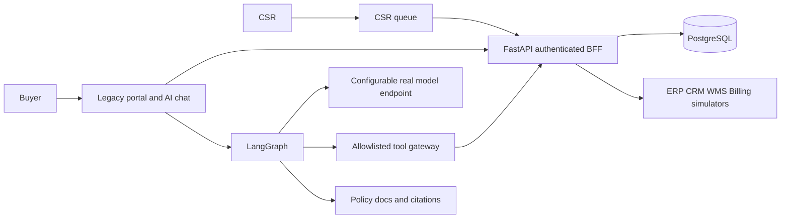
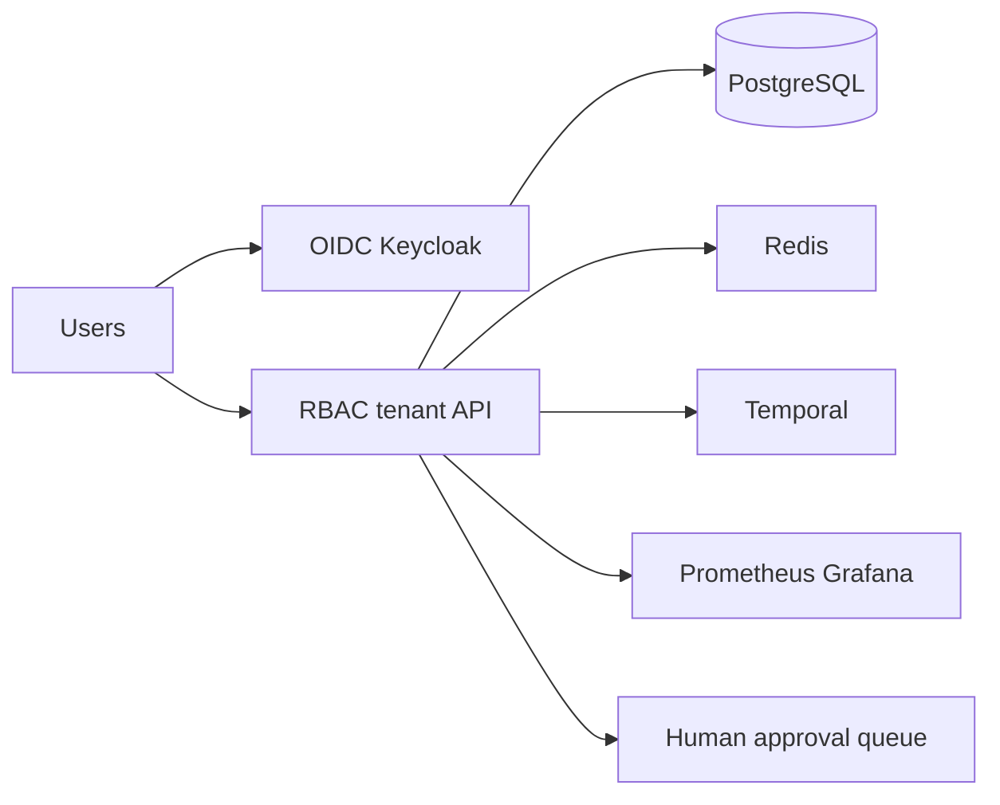
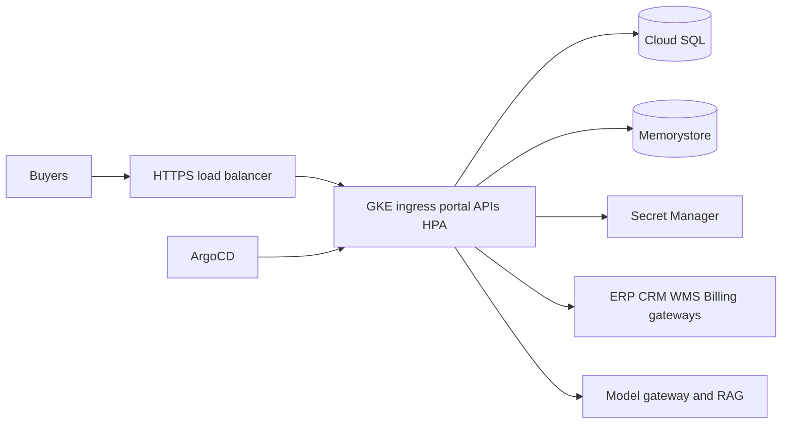

# Architecture and customer journey
## POC

## Pilot

## Production target—not deployed

## Journey
Login -> verified account -> catalogue/contract price/availability -> order tracking/invoices -> draft -> review snapshot -> explicit nonce and idempotency confirmation -> server-side revalidation -> authoritative order ID -> delivery updates/ticket or human handoff.