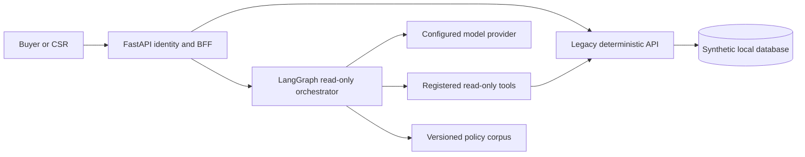

# POC — enterprise architecture validation
Status: POC, not an internet-safe production deployment.

## Business demonstration
A tenant-bound wholesale customer authenticates using local demo credentials, asks the LangGraph assistant about invoices, catalog prices, and order status; the agent invokes *read-only* business tools. The customer can independently create an order draft and must explicitly confirm it through the deterministic FastAPI order workflow.

## Trust boundaries
Browser -> FastAPI identity -> tenant-scoped SQL adapters. Agent responses, policy text and tool output are untrusted. The model cannot execute SQL or initiate mutations; application services recheck price, stock, identity, nonce and idempotency keys. The legacy portal must continue working when model inference fails.

## Architecture

## Evaluation gates
- Replay golden data from evals/golden.jsonl with a real configured provider; record tool accuracy, hallucinations, latency and cost.
- Negative tests: unauthorized tenant, prompt injection, forged tenant ID in prompt, duplicate confirmation, expired nonce, out-of-stock recheck, missing model endpoint.
- Prove the model cannot mutate an order; prove deterministic order status works when LLM is down.
- Record measured results, failure examples, model identifier, prompt version and dataset hash in docs/TEST_RESULTS.md.

## Go / no-go
Do not promote until full automated API tests and model evaluations pass, no cross-tenant disclosure occurs, and customer-facing answers cite verified data. No production credentials or personal customer data in this branch.
