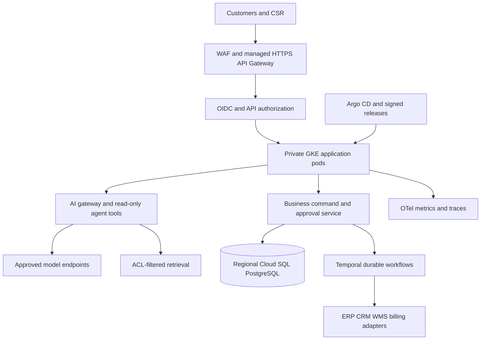

# Production — release design and verification obligations
Status: infrastructure-as-code target, **not verified as deployed or operational**.

## Execution and trust zones

External API gateway and AI gateway serve different purposes. LLMs never authorize or commit orders, refunds or inventory adjustments.

## Blockers before production approval
1. The existing Temporal CRM activity is a synthetic placeholder; wire a real idempotent adapter and worker deployment.
2. Helm values contain REPLACE placeholders; configure protected GitOps environment overlays and immutable image digests.
3. Provision actual DNS, TLS, managed edge protection, ingress gateway, OIDC, egress restrictions, and workload identities. A ClusterIP Service is not public ingress.
4. The existing network policy permits ingress only and **does not deny egress**; define tested DNS, Google APIs, model-provider and private database egress controls before enabling default-deny egress.
5. Managed Cloud SQL password is currently a Terraform sensitive variable; Terraform state still contains it. Prefer IAM database authentication or a separately provisioned secret with enforced rotation and protected backend state.
6. Validate autoscaling and rollout behavior against load, DB connection limits, provider rate limits, and PDBs; confirm multi-zone scheduling rather than assuming it.
7. Configure transactional outbox or equivalent reliable publication for state-change events; ensure reconciliation with remote ERP/WMS.
8. Provide authoritative ACL-indexed retrieval; current synthetic in-memory policy lookup is not enterprise RAG.
9. Configure cross-region restore feasibility, encrypted PITR, access/key recovery, tested RPO/RTO, alerting independent of AI, and owner runbooks.
10. Implement immutable artifacts, SBOM, vulnerability gates, OIDC workload federation, admission policies, GitOps promotion approvals and rollback verification.

## Initial targets (proposals, not measurements)
API availability 99.9% monthly; p95 application latency and model response times require load-test baselines; customer transaction RPO 5–15 minutes and RTO 1 hour are design candidates requiring business signoff.

## Release gates
Threat model signed; tenant isolation verified; zero unauthorized tool writes; approval and order idempotency proven; safe LLM-failure fallback; model and retrieval evaluations pass; CI/SBOM/signing checks pass; restore drill and incident simulation pass; CSR and finance owner acceptance recorded.

## Safe operating model
Deploy to staging from immutable image digest, run E2E and AI security evaluations, review diff/approvals, then controlled production canary. Alert on SLO burn rate, failed transactions, approval backlog, workflow retries and model gateway error/cost metrics. Revert app version without rolling back committed financial transactions.
