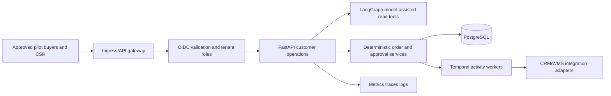

# Pilot — controlled enterprise integration
Status: limited test cohort only; do not claim production-ready.

## Architecture

The agent has no direct write credential for ERP/CRM/WMS. Every mutation must pass application authorization, idempotency and audit. The pilot approval endpoint uses atomic pending-to-final state transition.

## Integration decision
The existing Temporal delivery-exception activity returns SYNTHETIC-TICKET; **this is not a working CRM integration**. Before customer pilot use, replace that activity with an idempotent CRM adapter, separate retryable network errors from non-retryable validation, configure activity retries and a dead-letter/manual recovery process, and validate replay after worker interruption.

## Tenant and data requirements
Signed OIDC JWT with verified issuer/audience; server-derived tenant and customer; explicit RBAC. Synthetic or sanitized data only unless data-processing approval is granted. ACL filters must run before assembling any retrieval context. Segregate caches, database queries and logs by tenant.

## Acceptance gates
- Pilot cohort and approved rollout/kill switch documented; zero model write permissions.
- Concurrency test for duplicate approval submissions and order idempotency.
- Downstream CRM timeout, workflow worker restart, retry, DLQ/manual escalation and eventual reconciliation tests.
- OIDC unknown role, expired token, wrong audience and cross-tenant negative tests.
- Measured task completion, tool errors, answer quality, p95 latency, LLM spend and human escalation.
- CSR UAT signoff, security review and production-operating-owner signoff.

## Rollback
Disable PILOT_AI_ENABLED, continue deterministic service and CSR operations, preserve pending approvals and transaction audit, and route incidents to the assigned on-call operator.
