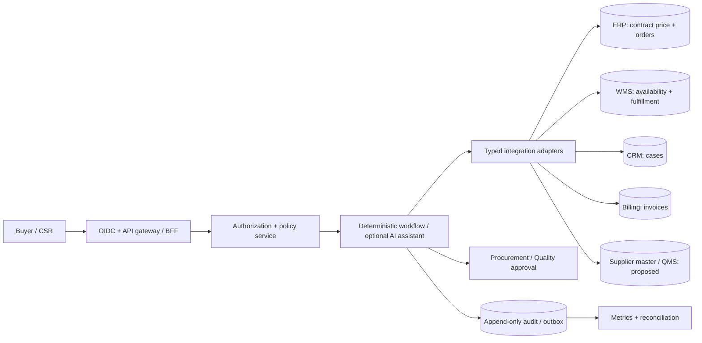

# Enterprise integration plan: order, fulfillment and supplier controls

**Status:** architecture proposal. Existing simulated ERP/CRM/WMS/billing adapters are not proof of real enterprise integration; supplier integration is a **new proposed capability**, not an existing endpoint.

## Context diagram


## Contract inventory
| System | Direction / data | Pattern | Owner | Failure behavior |
|---|---|---|---|---|
| ERP | customer contracts, SKUs, quote, order create/status | Versioned REST, adapter, idempotent POST | ERP owner | Fail closed for commitments; reconcile UNKNOWN |
| WMS | available-to-promise, allocation, shipment events | GET + signed webhook/event consumer | Warehouse IT | Mark stale; do not invent stock or delivery |
| CRM | customer case open/status and escalation | REST, correlated case ID | CRM owner | Queue retry for safe case creation |
| Billing | invoice lookup/dispute state | Read API + controlled dispute creation | Finance IT | Return unavailable; no payment-state guesses |
| Supplier master / QMS | vendor identity, scope, document/evidence version, expiration, hold state | Proposed versioned REST/events | Procurement/Quality | Unknown or expired -> HOLD, escalate |
| Identity | tenant, user, role, delegated grants | OIDC/OAuth2 + policy | IAM owner | Deny on missing/mismatched claims |

## Proposed canonical contract
Every interaction includes tenant_id (server-derived), correlation_id, actor_id, source_system, source_record_id, source_version, event_time UTC, schema_version; writes additionally use idempotency_key, approval_reference when required, and current policy_version. Never trust a tenant ID or price provided solely by a model/client.

Example **illustrative** supplier eligibility input:
```json
{"supplier_id":"SYN-S001","item_id":"SYN-SKU-100","site_id":"SYN-WH1","as_of":"2026-01-01T00:00:00Z","required_evidence_types":["quality_certificate"],"tenant_id":"server-derived"}
```
Example evaluation output:
```json
{"decision":"HOLD","reason_codes":["EVIDENCE_MISSING"],"supplier_version":"v1","policy_version":"draft-1","requires_human_approval":true,"correlation_id":"example-only"}
```
These shapes are **specifications**, not implemented API guarantees.

## Integration sequence and data reconciliation
1. Register system owner, classification, authoritative fields and rate limits; approve purpose and access.
2. Contract-test adapter against synthetic fixtures; validate pagination, timeouts, signatures, schema version and PII redaction.
3. Map source keys to tenant-scoped canonical IDs; record provenance and freshness; avoid direct model/database writes.
4. GET requests: bounded retry/backoff/circuit breaker; show stale data explicitly.
5. Writes: consent/approval -> recheck authority -> transactional outbox and idempotent adapter -> acknowledgement or UNKNOWN -> reconcile by external reference. Never retry non-idempotent actions blindly.
6. Subscribe to webhook/events with signature verification, dedupe, ordering strategy, dead-letter queue and bounded replay.
7. Daily exception report of uncorrelated or aged records; named owner resolves before closure.

## Release and recovery
Use feature flags per integration and tenant; canary against synthetic then approved pilot accounts; verify contract tests, access controls, backfill integrity, backlog drain and rollback; document compensating actions. Record provider-specific API versions, SLAs, webhook authentication, data retention, residency and disaster recovery only after owner confirmation.
