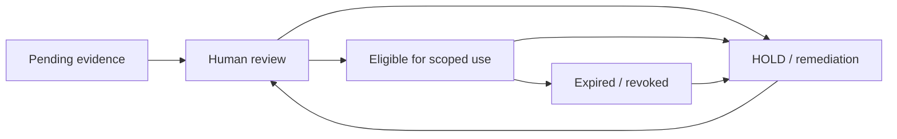

# Supplier compliance and fulfillment release: proposed controls

**Design only — supplier compliance is not yet verified as an implemented product feature.** Define jurisdiction, category, customer contract and required evidence with Procurement/Quality and counsel. Do not claim certification or regulatory compliance from this document.

## Policy ownership
Supplier Quality owns requirement matrix and evidence acceptance; Procurement owns supplier onboarding and remediation; Supply Chain owns affected fulfillment; IT owns integration and audit; Security owns access and retention. AI may summarize cited policy and open a case, but cannot certify a supplier or release a blocked order.

## Eligibility state machine

Eligibility is per **supplier + product/category + site + tenant + effective date**, not a global Boolean. No evidence, revoked document, ambiguous identity, out-of-scope certificate or unavailable QMS results in HOLD.

## Proposed minimum evidence schema
supplier_id, tenant_id, product_scope, site_scope, certificate_type, issuer, document_reference (secure object-store pointer; no raw file in event), valid_from, expires_at, revocation_status, verification_method, verifier_id, verified_at, policy_version, source_version, sensitivity/retention class.

## Request -> decision -> exception
1. Resolve authoritative supplier and purchase/order references, current policy and evidence requirements.
2. Verify scope, issuer/verification process, expiry, revocation, ownership and freshness.
3. Decide ELIGIBLE only when every mandatory requirement passes, with effective period and evidence hash recorded.
4. Otherwise issue HOLD with reason codes; create procurement/quality case, notify fulfillment owner, and prevent auto-release.
5. Authorized Quality approver may grant narrowly scoped, time-limited exception after review; require reason, dual control when policy says so, and immutable audit.
6. On renewal/revocation/recheck, recalculate and notify downstream order/warehouse queues; reconcile conflicting system states.

## Required negative tests
- Missing document, expired at validation time, revoked after previous approval.
- Certificate valid for another site, product, tenant or supplier.
- Clock skew, evidence storage unavailable and supplier master timeout.
- Prompt injection asking agent to mark compliant, forged approval and replayed override.
- Role lacking Quality approval, concurrent approval and expired exception.
- Partial shipment with mixed compliant/noncompliant suppliers.
Expected result: no autonomous release, actionable HOLD reason, audit/trace and human path.

## Deployment criteria
POC: mocked eligibility rules and negative tests; pilot: legal/Quality-approved matrix, source contract, seeded UAT and signoffs; production: evidence retention/consent, independent controls testing, revocation feed, monitoring and incident runbook. Until then label UI and reports **simulation**.
